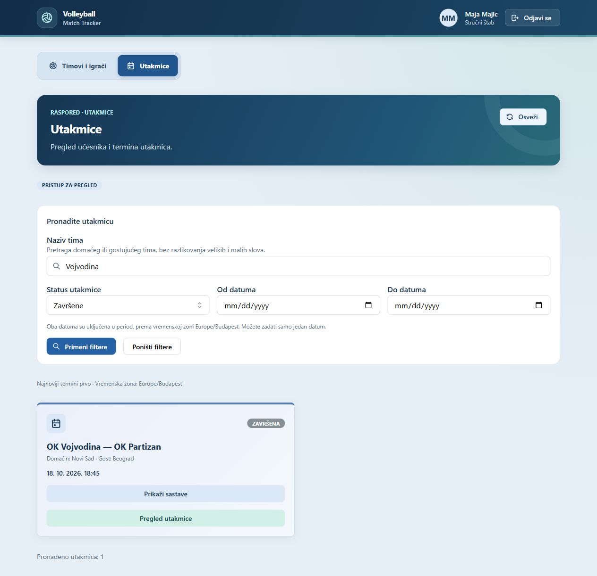

# Volleyball Match Tracker

A full-stack web application for recording volleyball matches and reviewing team
and player statistics. Statisticians manage the match; coaching staff follow it
through a read-only view that refreshes automatically.

## Features

- Registration, session-based login/logout and administrator approval or blocking
  of accounts; role-based access, CSRF protection and Argon2id password hashing.
- Team and player management, match scheduling, search and status/date filters.
- Match-specific rosters, libero designation and starting lineups for each set.
- Point recording with optional action/player details, score corrections,
  service and rotation tracking, ordinary substitutions and libero replacements.
- Set and match completion, team/player statistics by set or whole match, and
  rule-based review suggestions with minimum sample and data-coverage checks.
- Version checks and idempotent scoring commands to handle concurrent changes
  and uncertain network responses.

The interface is in Serbian. Review suggestions use application heuristics,
not machine learning, and are not validated tactical advice.

## Preview

## Stack

- Java 21, Spring Boot, Spring Security, Spring Data JPA, Maven
- PostgreSQL 18 and Flyway migrations
- React, TypeScript, Vite and Mantine UI
- Docker Compose for the local database
- JUnit, Testcontainers, Vitest and Testing Library

## Try it locally

Prerequisites: Java 21, Maven 3.6.3+, a supported Node.js release
(22.22.2+, 24.15+ or 26+), and Docker with Linux containers.

**For a prepopulated demo**, follow [the demo guide](docs/DEMO.md). It uses a
separate database, volume and ports, creates fictional teams/players and three
demo accounts, and asks you to choose a local password. It does not populate or
reset your regular development database.

**For normal development:**

1. Copy `.env.example` to `.env` and set a local database password. Do not
   overwrite an existing configuration or commit the resulting file.
2. For a fresh database, configure the [initial administrator](docs/SETUP.md#initial-administrator).
   Registration alone cannot create or approve an administrator.
3. On Windows, double-click `Pokreni.cmd`. It starts the database and app,
   then opens [localhost:5173](http://localhost:5173).
4. After the initial admin is created, disable bootstrap, remove the temporary
   admin credentials and restart the backend. Register other accounts and approve
   them as administrator.

Use `Zaustavi.cmd` to stop the regular local environment without deleting its
database volume. The demo has its own start/stop instructions.
See [setup and terminal commands](docs/SETUP.md) for other operating systems and
details about prerequisites, ports and local configuration.

## Checks

Backend, from `backend/` with Docker running:

~~~shell
mvn verify
~~~

Frontend, from `frontend/`:

~~~shell
npm ci
npm run check
npm test
npm run build
~~~

Backend integration tests use disposable PostgreSQL containers, not the
development or demo database. Coverage includes authentication/authorization,
validation, concurrent writes, score corrections, complete match flows and safe
demo initialization. Frontend tests cover validation, request handling and UI
workflows; jsdom tests do not establish visual correctness.

[GitHub Actions](.github/workflows/ci.yml) defines backend, frontend and Windows
launcher checks. A successful local run does not establish a successful hosted
run; Actions must be checked after publishing the repository.

## Documentation

- [Local setup, initial administrator and verification](docs/SETUP.md)
- [Isolated demo and a short walkthrough](docs/DEMO.md)
- [Data model, API and match rules](docs/TECHNICAL.md)
- [Manual demonstration checklist, Serbian](docs/PROVERA_APLIKACIJE.md)

## Scope and limitations

This is a local development application, not a complete official refereeing
system. It implements ordinary match workflows, not every exceptional
substitution, sanction or competition-specific roster rule. Teams are shared
within the application; there is no separate club ownership.
